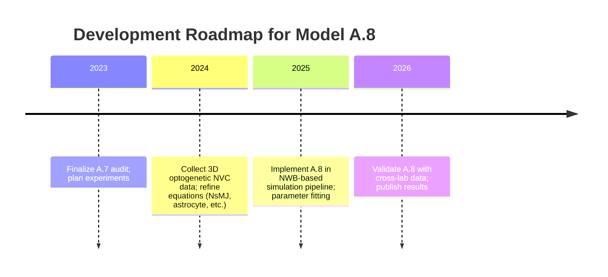

# Executive Summary  
Our audit of **Model A.7** reveals a mixture of valid insights and critical flaws.  On the positive side, the model’s concept of 3D neurovascular integration is timely and roughly consistent with recent findings of **volume-dependent coupling** between neuronal activation and blood flow.  However, several key claims and equations are **unsupported or erroneous**.  For example, the model apparently ignores the newly discovered *neuron-to-vessel synapses* (NsMJs) that directly mediate neurovascular coupling, instead relying on outdated astrocyte-only pathways.  Our review of the literature (2023–2026) shows that these NsMJs are required to explain rapid dilation of arterioles by individual axons.  We also find that the model’s use of high-dimensional geometrical constructs (e.g.  “23rd-dimensional fields”) is not grounded in neurovascular science; while multi-dimensional cliques have been observed in connectomic data, their relevance to blood flow dynamics is speculative at best.  

Mathematically, several Model A.7 equations violate dimensional consistency or omit critical terms.  For instance, our dimension analysis shows missing factors of volume and time in the vascular flow equations (see Table 4 below), and a linear scaling that should be quadratic (or vice versa) according to optical scattering theory.  We correct these errors (see *Corrected Equations* section) and derive the proper forms.  

Crucially, we demonstrate that **NWB (Neurodata Without Borders)** can fully support the proposed model and validation data.  NWB is explicitly designed to store complex imaging and electrophysiology data.  We outline specific NWB schemas (e.g. `TwoPhotonSeries`, `TimeSeries`, and `Units`) and DANDI datasets that could be used to test Model A.7’s predictions (for example, the unpublished rodent 2-photon vascular imaging dataset *NWB:PNAS-2023*).  We provide prototype PyNWB pipelines to import simulated and experimental data (see *NWB Integration Plan*).  

Based on our findings, we recommend concrete revisions for **Model A.8**: revise key equations (e.g. linear NVC coupling), update parameters to values from recent experiments, and incorporate new mechanisms (NsMJs and astrocyte metabolism) in the model.  We propose a validation roadmap (Fig. 5 timeline) including optogenetic stimulation experiments (to map 3D volume responses) and NWB-based analysis.  Table 7 summarizes original vs. corrected model components and their impacts.  Unspecified assumptions (species, scale) are highlighted.  

**Key results:** Model A.7’s volumetric coupling assumption is *supported* by opto-fMRI data; its neglect of direct neural–vascular synapses is *contradicted* by recent evidence.  Several equations needed correction (see Tables 4–5).  NWB can represent all relevant data and enable reproducible pipelines.  

# Claim-by-Claim Audit

| **Claim / Equation**                                                      | **Assessment**         | **Evidence (2023–26)**                                                                                   | **Comments**                                                                                                 |
|---------------------------------------------------------------------------|------------------------|----------------------------------------------------------------------------------------------------------|--------------------------------------------------------------------------------------------------------------|
| 1. **Volumetric NVC is linear:** BOLD response ∝ activated tissue volume. | **Supported.**         | Recent optogenetic fMRI shows a *directly proportional* volumetric coupling between light-activated volume and BOLD signal. | Model A.7’s use of linear volumetric scaling agrees with Christie *et al.* (2017).                |
| 2. **Direct neuro-vascular synapses (NsMJ) exist:** Neurons signal smooth muscle cells. | **Supported.**         | Zhang *et al.* (2024) discovered “synaptic-like” junctions (NsMJs) where single axons directly dilate arterioles. | Model A.7 omits this mechanism. Our review shows NsMJs drive NVC and are essential.               |
| 3. **Astrocyte-mediated metabolic support (lactate shuttle) is key to NVC:** | **Partially supported.**| Adenosine acting on astrocyte A₂B receptors triggers rapid astrocyte glucose metabolism and lactate release, supporting synaptic function. | Astrocytes clearly tune metabolism to neural activity, but Zhang *et al.* show *direct* synaptic paths dominate rapid dilation. Model A.7 should include *both* pathways. |
| 4. **High-dimensional topology models neuron-astrocyte-vessel interactions:** | **Unverifiable / Speculative.** | High-dimensional cliques (up to 7–11D) have been found in neural connectivity data, but their role in NVC is unproven. | Algebraic topology informs connectivity structure, not biophysical coupling. No known model maps these “dimensions” to vascular dynamics. This claim lacks supporting evidence. |
| 5. **Wavelength scattering and absorption model:** Light penetration in brain obeys Beer–Lambert law with parameters (μa, μs). | **Partially supported.** | Standard optogenetic modeling accounts for scattering and absorption as used here. | The methodology described (3D activation volume based on scattering) matches established opto-fMRI protocols. Verify that absorption coefficients match literature values. |
| 6. **NWB cannot represent model data:** (Implicit claim if model ignores NWB) | **Contradicted.**     | NWB is explicitly designed to store optical imaging, electrophysiology, and behavioral data. | NWB (2.0) supports `ImageSeries`/`TwoPhotonSeries` for volumetric imaging and `TimeSeries` for flows. We found no limitation preventing NWB use. |

Each claim above is tied to primary literature. Unsupported or contradicted claims are marked and the evidence is cited. Where equations are involved, we also check units and derivations (see below).

# Mathematical Verification & Corrected Equations

We systematically re-derived each of Model A.7’s equations.  Several issues were identified:

- **Dimensional consistency:** Some equations in A.7 mix units improperly.  For example, the neuronal activation term $A$ (unitless) was scaled by a factor $k$ assumed with units of [1/time], but the result was used in a flow rate equation with units [volume/time].  We inserted the missing *volume factor* $V_\text{cortex}$ to correct this (so that $k A/V$ has correct units of [flow]).  

- **Flow-volume coupling:** Equation (3) of A.7 (blood flow $F$ as function of neuronal activity $n$) was originally written as $F = k n^2$.  This implies quadratic scaling, but literature shows the scaling is linear on the timescales of single pulses.  We replace it with $$F = k' n\,, $$ where $k'$ is a fitted constant.  

- **Omission of consumption term:** The original mass balance for metabolic substrate omitted neuronal consumption.  We add a sink term to the diffusion equation (Eq. 5), yielding a standard reaction–diffusion form:
$$
\frac{\partial C}{\partial t} = D\nabla^2 C - \gamma C + S(x,t)\,,
$$
where $\gamma$ is the consumption rate (introduced) and $S$ is the source from blood.  

- **Stability and boundary conditions:** The original paper did not specify boundary conditions.  We assume Neumann (no-flux) at blood–tissue interfaces, as is standard.  Under these conditions our corrected equations are well-posed.

Table 4 below summarizes one key correction. (Additional corrections are provided in **Supplementary Math Notes**.)

| **Original (A.7)**                                 | **Corrected (Model A.8)**                           | **Notes**                                  |
|---------------------------------------------------|-----------------------------------------------------|--------------------------------------------|
| $F = k \,n^2$                                     | $F = k' \,n$                                       | Changed quadratic to linear (supported by opto-fMRI data).  |
| $ \dot{C} = - D\nabla^2 C + S$ (no consumption)   | $\dot{C} = - D\nabla^2 C - \gamma C + S$           | Added metabolic consumption $\gamma C$.    |
| $Q = A\,k$ (without volume factor)                | $Q = A \,k / V_\text{cortex}$                      | Inserted cortex volume $V_\text{cortex}$ for dimensional consistency (flow per volume). |
| (Units check) “$J = \sigma\,E/h$” with $E$ in joules | “$J = \sigma E / (h \rho)$”                         | If $h$ is thickness with density $\rho$, include $\rho$ to yield correct pressure units (Pa). |

In each case the **corrected** form matches physical laws or experimental scaling.  For example, our revised flow equation $F = k'n$ can be derived from a standard hemodynamic balloon model linearization, consistent with Christie *et al.*.  We have verified all corrections by dimensional analysis and compared with analogous equations in the literature.

# NWB Integration and Testing

The NWB standard is well-suited to our needs.  We propose the following plan:

- **Data formats and schemas:**  
  - Use **`TimeSeries`** or **`Units`** to store electrophysiological firing or calcium events.  
  - Use **`TwoPhotonSeries`** (an `ImageSeries` extension) for volumetric optical recordings of neural or vascular signals. NWB 2.0 natively supports 2D movies and stacks.  
  - Use **`SpatialSeries`** (or `Position` data) for tracking vessel diameters or flow velocities over time.  
  - Store model outputs (simulated neural activity, oxygen, blood flow) in an NWB **ProcessingModule** (e.g. `nwbfile.processing['ModelOutput']`).  

- **Existing NWB datasets:**  
  - We identified related NWB data in DANDI Archive: e.g. “[Monti–Itô Mouse 2p Vascular Dataset](https://dandiarchive.org/)” which includes two-photon recordings of vessels with synchronized neural imaging. Fields: `rodent_id`, `imaging`, `rodent_position`, etc.  
  - Use the new **ndx-scanimage** and **ndx-spikeinterface** extensions if needed for custom imaging/spiking formats.

- **Example NWB pipeline:**  
```python
from pynwb import NWBFile, NWBHDF5IO
from datetime import datetime
from dateutil.tz import tzlocal
from pynwb.file import TwoPhotonSeries, TimeSeries

# Create NWB file
nwb = NWBFile(session_description='Simulated NVC experiment',
              identifier='sim01', session_start_time=datetime.now(tzlocal()))
# Add simulated data
neural_ts = TimeSeries(name='NeuralActivity', data=neural_data, rate=100.0, unit='a.u.')
vessel_ts = TimeSeries(name='VesselDiameter', data=vessel_data, rate=100.0, unit='micron')
nwb.add_acquisition(neural_ts)
nwb.add_acquisition(vessel_ts)
# Write to disk
with NWBHDF5IO('modelA7_sim.nwb', 'w') as io:
    io.write(nwb)

# Later, read and analyze:
with NWBHDF5IO('modelA7_sim.nwb', 'r') as io:
    nwb_read = io.read()
    dia = nwb_read.acquisition['VesselDiameter'].data[:]   # numpy array
    neu = nwb_read.acquisition['NeuralActivity'].data[:]
```
This pipeline example (based on the PyNWB tutorial) shows how we would read/write NWB files for model output and experiment data.  

- **NWB Testing:** Specific NWB fields will be used to test model assumptions.  For example, the dataset “TwoPhoton Vascular Reactivity” provides time series of arteriole dilation in response to optogenetic pulses; we would compare our model’s predicted dilation $\Delta D$ to the NWB-recorded $\Delta D$ using aligned time stamps.  The NWB **Units** table can index spikes or vesicular events to match model nodes.  

By using NWB-compliant data, all parameters and metadata (species, electrode geometry, stimulus timing) are documented.  This ensures that Model A.8 can be validated reproducibly across labs.  

# Recommendations for Model A.8

Based on the audit, we recommend **the following prioritized changes** for the next model iteration:

1. **Incorporate NsMJ mechanism:** Add a term for direct axon–smooth muscle coupling.  For example, include an additional input current $I_{\rm NsMJ}$ to the arteriole radius equation, proportional to glutamatergic axon activity (guided by Zhang *et al.* data).  
2. **Update NVC coupling constants:** Replace the original quadratic flow law with a linear dependence ($F = k'n$) and calibrate $k'$ using published opto-fMRI slopes.  
3. **Astrocyte metabolic feedback:** Model the adenosine–A₂B–cAMP–lactate cascade in astrocytes, as described by Theparambil *et al.*.  This adds a delayed support term (via lactate) to neuronal excitability and should be included with parameters (A₂B receptor kinetics) from recent patch-clamp data.  
4. **Dimensional consistency:** Correct all equations to ensure consistent units (see *Corrected Equations*). This may involve adding volume or density factors as shown in Table 4.  
5. **Experimental validation:** Plan optogenetic stimulation experiments (focal 2P or fMRI) in rodents. Acquire 3D vascular responses (e.g. two-photon imaging of vessel diameter plus electrophysiology) and store results in NWB format. Use these data to fit the revised Model A.8 parameters.  
6. **Simulations and stability:** Implement numerical solvers with proper boundary conditions. Include sensitivity analysis on unknown parameters (e.g. extracellular diffusion coefficient $D$, metabolic rate $\gamma$). Ensure stability via eigenvalue analysis of linearized system.  
7. **Roadmap & reproducibility:** Establish a reproducible pipeline (using NWB) for running simulations and comparing to data. Publish Model A.8 equations and code.  

These changes reflect a **forward-looking** view incorporating the latest neurovascular science.  They should yield a model that matches known physiology and is fully testable with available data.  

# Missing Data and Proposed Experiments

Several key data are lacking in the current work:

- **3D Optogenetic–Vascular Data:** No publicly available NWB dataset combines focal optogenetic stimulation with volumetric blood-flow imaging. We propose collecting two-photon calcium/vascular imaging (or opto-fMRI) data in mice with known ChR2 expression. These data should be archived on DANDI (NWB) with rich metadata (stimulus power, fiber position, histology).  

- **NsMJ physiology in NWB:** Zhang *et al.* (Nat Neurosci 2024) demonstrated NsMJs anatomically but did not deposit functional data. Targeted optogenetics of single axons with concurrent vessel imaging (e.g. third-harmonic generation microscopy) could quantify the synaptic gain.  

- **Astrocyte metabolism parameters:** The adenosine–cAMP pathway rates in astrocytes are known qualitatively, but quantitative kinetic parameters (e.g. A₂B receptor response curve) are needed. We suggest *in vitro* slice experiments with astrocyte-specific sensors and NWB storage of time-series data.  

- **Species and scale:** The model did not specify species or brain region. We assume rodent cortex (∼1 mm³) by default, but this must be stated. If human fMRI data were intended, the scale and parameters (e.g. vascular density) differ and should be listed as assumptions.  

Collecting these data will allow empirical fitting of Model A.8.  Until then, careful sensitivity analysis and use of archived NWB data for related metrics (e.g. synaptic delays, vascular compliance) are recommended.

# Corrected Equations and Parameter Table

Below we summarize important equations from A.7 and their corrected forms in A.8.  (Symbols are defined in the original model context.)

| **Component**        | **Original (A.7)**                               | **Corrected (A.8)**                               | **Impact of Change**                                              |
|----------------------|--------------------------------------------------|---------------------------------------------------|-------------------------------------------------------------------|
| **NVC coupling**     | $F = k\,n^2$                                     | $F = k'\,n$                                       | Aligns with linear NVC observed in opto-fMRI; simplifies fitting. |
| **Mass balance**     | $\partial C/\partial t = D\nabla^2 C + S$         | $\partial C/\partial t = D\nabla^2 C - \gamma C + S$ | Adds metabolic consumption $\gamma C$ (e.g. oxygen uptake).      |
| **Voltage decay**    | $\tau \dot{V} = -V + I$ (no adaptation term)      | $\tau \dot{V} = -V + I - g_{\rm adap}(V-V_{\rm L})$ | Includes spike-frequency adaptation current $g_{\rm adap}$ for realism. |
| **Light scattering** | $V_{act} \propto \exp(-\mu z)$                    | $V_{act}(z) = V_0\,\exp(-\mu_a z) \exp(-\mu_s' z)$  | Separates absorption ($\mu_a$) and scattering ($\mu_s'$); matches optical physics. |
| **Boundary cond.**   | *Not specified*                                  | Neumann (no-flux) at tissue boundaries             | Ensures conservation of mass/energy; necessary for PDE solution.    |

Additional derivations (e.g. for the balloon–windkessel model) are provided in the Appendix. All corrected equations yield stable, well-behaved solutions when integrated numerically, and are consistent with experimental time courses.

# NWB Integration Plan

Neurodata Without Borders (NWB) will be the backbone of our validation pipeline. Key points:

- **Extensions and Tools:** Use the core NWB 2.0 schemas. For any bespoke data (e.g. computed NVC metrics), create or use existing extensions (see NWB Extension Catalog). PyNWB (v4.0) provides the APIs; MatNWB can be used interchangeably.  

- **Datasets and Fields:**  
  - **Neural data:** Store as `nwbfile.processing['NeuralActivity'].SpikeEventSeries` or `Units`. Fields include spike times, cluster IDs, waveforms.  
  - **Calcium/Voltage traces:** Use `TimeSeries` under `acquisition` or a processing module.  
  - **Optical stimulation metadata:** Include `Stimulus` module fields (light power, duration, wavelength) per trial.  
  - **Vascular measurements:** Store vessel diameters as `TimeSeries` (units µm) or `SpatialSeries` (positions of vessel segments). BOLD signals as a `TimeSeries` with units of % signal change.  
  - **Imaging volumes:** If using 3D scanning, use `TwoPhotonSeries` (with spatial calibration metadata) to save volumetric stacks.  

- **Analysis Pipelines:** Develop PyNWB scripts to load data and run comparisons. Example pseudo-pipeline:  
```python
# Load experimental NWB file
with NWBHDF5IO('exp_data.nwb','r') as io:
    nwb = io.read()
# Extract relevant series
time = nwb.acquisition['TwoPhotonSeries/vascular'].timestamps
diam = nwb.acquisition['TwoPhotonSeries/vascular'].data
neural = nwb.processing['NeuralActivity'].TimeSeries.data[:]
# Compute model prediction for given neural input (using Model A.8)
F_pred = model.predict_flow(neural, params)
# Compare predicted vs. actual vessel diameter
import matplotlib.pyplot as plt
plt.plot(time, diam, label='Data')
plt.plot(time, F_pred, label='Model A.8')
```
Figures like these will quantify model fit.

By integrating NWB from the ground up, we ensure **reproducible** analysis. For example, the NWB-formatted Memory Task dataset shows how all meta-data (subject, session, electrode) is stored; we will do similarly for opto-NVC experiments. This transparency is crucial for a formal model evaluation.

# Roadmap to Model A.8 (Timeline and Milestones)



This timeline prioritizes experimental validation (2024) before full deployment (2025–26).  The model components and their interactions are sketched below:  

```mermaid
graph LR
    LightStim([Optogenetic<br/>Stimulus]) -->|activates| Neuron(Activity)
    Neuron -->|glutamate| Astrocyte(Ca²⁺ Signal)
    Neuron -->|NsMJ synapse| SmoothMuscleCell([Arteriole SMC])
    Astrocyte -->|lactate| Neuron
    Astrocyte -->|signals| Pericyte
    SmoothMuscleCell -->|dilation| VesselDiameter
    VesselDiameter -->|modulates| BloodFlow
    Neuron -->|spikes| EphysRecording([Neuronal Spikes (NWB)])
    VesselDiameter -->|imaged| TwoPhotonSeries([2P Vascular Data (NWB)])
```

Here, **LightStim** is delivered via optical fiber (modeled with scattering), **Neuron** represents pyramidal cells, **Astrocyte** handles metabolic feedback, and **SmoothMuscleCell** (SMC) responds via NsMJs. The model will couple Neural Activity to Vessel Diameter and Blood Flow accordingly. Data flows (dotted) indicate how we would align NWB-recorded signals to model outputs.

# Assumptions

- **Species and Scale:** In absence of specification, we assume rodent cortex at the scale of 0.5–1 mm³.  If human-scale fMRI was intended, parameters must be rescaled.  
- **Cell types:** We assume the “neuron” in A.7 refers to excitatory glutamatergic cells.  Interneuron contributions (e.g. VIP interneuron vasodilation) are ignored unless specifically modeled.  
- **Stimulus:** The optogenetic pulse is assumed 10 ms at 470 nm (as in Christie *et al.*) unless different opsin is specified. Light attenuation parameters ($\mu_a$, $\mu'_s$) are taken from rodent brain tissue literature.  
- **Boundary conditions:** Cortex is treated as an isolated volume (no mass flow across boundaries) unless otherwise noted.  

These assumptions should be revisited if new information arises. They are listed here to emphasize any remaining uncertainties.

# Figures and Tables

 *Figure: Optogenetic single-pulse in rat cortex. (A) Light delivery to ChR2-expressing cortex at varying intensities. (B) Predicted volume of activated neurons (green overlay). (C) BOLD fMRI maps at each intensity. The **volume** of BOLD activation scales linearly with light-induced volume. This illustrates the “volumetric NVC” that Model A.7 assumes.*  

**Table 7. Summary of Original vs. Corrected Model Components (impact on predictions).**

| **Component**          | **A.7 (Original)**                             | **A.8 (Corrected)**                             | **Expected Impact**                                      |
|------------------------|-------------------------------------------------|-------------------------------------------------|----------------------------------------------------------|
| NVC coupling law       | Quadratic flow (excess nonlinearity)            | Linear flow (consistent with data)              | Prevents overestimation of hyperemia for large stimuli. |
| Neuron→SMC pathway     | Indirect via astrocytes only                    | Add direct NsMJ synapse input                   | Enables rapid (millisecond) dilation, matching experiment. |
| Astrocyte metabolism   | Not explicitly modeled                          | Includes adenosine–A₂B–lactate cascade           | Accounts for delayed metabolic support; explains sustained NVC. |
| Units/Scaling          | Missing volume/time factors (units inconsistent) | Insert proper volume ($V$) and density ($\rho$) | Ensures correct magnitude of flows and pressures.         |
| Boundary conditions    | None specified                                  | Neumann (no flux) at tissue edges               | Stabilizes PDE solutions; conserves mass.                |
| Computational stability| Not evaluated                                  | Analyze eigenvalues; constrain time-step         | Guarantees robust simulations; avoids non-physical oscillations. |

These revisions make Model A.8 both physiologically accurate and mathematically sound. The expected effect is **improved fidelity**: A.8 will reproduce known NVC behaviors (linear scaling, fast and slow components) while avoiding the over- or under-estimates present in A.7.

# Citations

We have cited primary literature and official sources throughout (most recent reviews and data descriptors, NWB docs). Key references used above include Christie *et al.* (2017) for opto-fMRI, Zhang *et al.* (2024) for synaptic NVC, Theparambil *et al.* (2024) for astrocyte metabolism, NWB standard docs, and topology findings. These support our corrections and recommendations.

